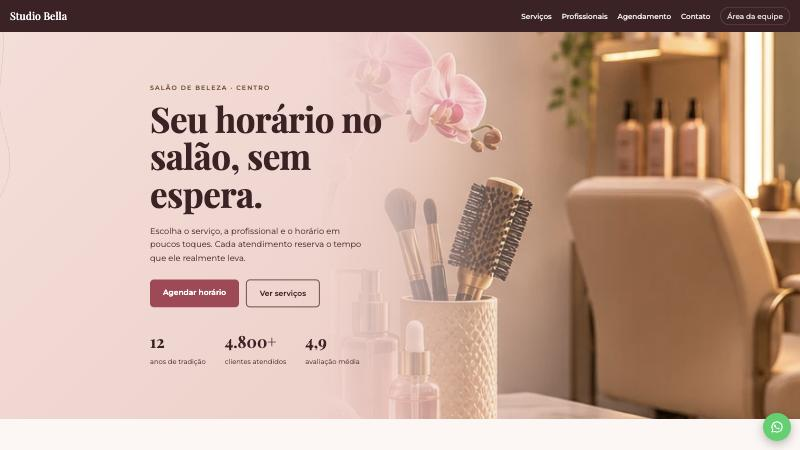

# Studio Bella — Sistema de Agendamento Online

Site de agendamento para um salão de beleza fictício, desenvolvido como
trabalho acadêmico. A cliente escolhe o serviço, a profissional, a data e
o horário direto pela página, e a equipe acompanha a agenda e o
faturamento por um painel interno.



## O problema que ele resolve

Em um salão, marcar horário por telefone ou WhatsApp tem três problemas
recorrentes: alguém precisa parar o que está fazendo para atender, a
cliente não enxerga quais horários estão realmente livres, e serviços de
duração muito diferente (uma sobrancelha leva 30 minutos, uma mecha leva
3 horas) acabam marcados em cima um do outro.

Este projeto ataca esses três pontos. A agenda é dividida em blocos de 30
minutos e **cada serviço reserva o número de blocos que realmente
consome**, então um horário que não comporta a duração do serviço aparece
indisponível antes de a cliente tentar marcar.

## Funcionalidades

**Para a cliente**

- Catálogo de serviços com duração e preço
- Agendamento guiado em 5 etapas, com validação em cada uma
- Horários indisponíveis aparecem riscados, considerando a duração do
  serviço e os horários que já passaram
- Cada profissional só aparece para os serviços que realmente atende
- Confirmação com envio do resumo pelo WhatsApp e adição ao Google Agenda
- Consulta e cancelamento dos próprios horários pelo telefone

**Para a equipe**

- Painel em página própria (`equipe.html`), protegido por senha
- Indicadores: agendamentos ativos, do dia, valor previsto, recebido e a receber
- Faturamento por profissional
- Filtros por profissional e por status
- Ações por agendamento: concluir, marcar como recebido, cancelar, excluir
- Exportação da agenda em CSV (separador `;`, pronto para o Excel)

## Tecnologias

HTML5, CSS3 e JavaScript puro (ES6+), sem framework e sem biblioteca
externa. A persistência usa a **Web Storage API** (`localStorage`) e a
interface usa elementos nativos como `<dialog>` para os modais. As únicas
dependências externas são as fontes, carregadas do Google Fonts:
**Playfair Display** nos títulos e **Montserrat** no texto corrido.
Ambas estão em variáveis CSS (`--serif` e `--sans`), então trocar a
tipografia do site inteiro é editar duas linhas.

Não há etapa de build: o que está no repositório é o que roda.

## Como executar

**Opção 1 — abrir direto**

Baixe ou clone o repositório e dê dois cliques no `index.html`. Funciona
em qualquer navegador moderno, inclusive sem internet (nesse caso só as
fontes deixam de carregar).

```bash
git clone https://github.com/isabelly-isa/Agendamento-.git
```

**Opção 2 — servidor local** (recomendado para desenvolvimento)

```bash
python3 -m http.server 8000
```

Depois abra `http://localhost:8000` no navegador.

## Como usar

**Agendando um horário**

1. Clique em **Agendar horário** ou vá até a seção Agendamento
2. Escolha o serviço — a duração e o preço aparecem em cada card
3. Escolha a profissional — só aparecem as que atendem aquele serviço
4. Escolha a data — próximos 14 dias de atendimento, sem domingos
5. Escolha o horário — os riscados estão ocupados ou não comportam a duração
6. Preencha nome, telefone e e-mail e confirme

Na confirmação dá para enviar o resumo pelo WhatsApp do salão ou salvar o
compromisso no Google Agenda.

**Consultando seus horários**

Clique em **Ver meus horários**, informe o telefone usado no agendamento
e a lista aparece, com opção de cancelar os que ainda estão marcados.

**Acessando o painel da equipe**

O painel tem página própria. Dá para chegar nele pelo botão **Área da
equipe**, no menu do site, ou direto pelo endereço:

```
http://localhost:8000/equipe.html
```

A senha padrão é `123456` e pode ser trocada em `assets/js/config.js`.
A página é marcada com `noindex`, para não aparecer em buscadores.

## Estrutura do projeto

```
Agendamento-/
├── index.html              site público (só marcação)
├── equipe.html             painel da equipe (só marcação)
├── README.md
└── assets/
    ├── css/
    │   └── style.css       toda a aparência, organizada por seção
    ├── img/
    │   ├── hero.jpg        foto do topo
    │   └── preview.jpg     imagem usada neste README
    └── js/
        ├── config.js       ← dados do salão: serviços, equipe, contato
        ├── core.js         base comum: armazenamento e regras da agenda
        ├── icons.js        desenhos SVG dos ícones de serviço
        ├── app.js          site público e assistente de agendamento
        └── equipe.js       painel da equipe
```

São duas páginas. O site público carrega `config.js`, `icons.js`,
`core.js` e `app.js`, nessa ordem; o painel carrega `config.js`,
`core.js` e `equipe.js`. O `core.js` guarda o que as duas usam —
leitura e gravação no `localStorage`, consultas ao catálogo e as
regras da agenda — para a lógica não ficar duplicada.

## Como personalizar

Quase tudo o que muda no dia a dia está em `assets/js/config.js`, sem
precisar tocar na lógica:

- **Serviços, preços e duração** — lista `SV`. A duração em minutos (`m`)
  define quantos blocos de 30 minutos o serviço ocupa. O campo `ic`
  escolhe o ícone entre os desenhos de `icons.js`.
- **Equipe** — lista `BB`. O campo `sv` diz quais serviços cada
  profissional atende: ele filtra a etapa 2 do agendamento e monta as
  etiquetas do card dela.
- **Depoimentos** — lista `DEPOIMENTOS`, com nome, texto e nota de 1 a 5.
- **WhatsApp, endereço e senha** — constantes `WHATS`, `ENDERECO` e `SENHA`.

O texto visível do endereço e do telefone fica no `index.html` (seção
Contato); os links desses itens são montados a partir do `config.js`.

### Imagens

O topo usa a foto `assets/img/hero.jpg`. No desktop ela é uma camada de
fundo que ocupa a metade direita da tela, sangrando até a borda, e se
dissolve em direção ao texto por uma `mask-image` em degradê — por isso
o texto fica legível mesmo sobrepondo a área da imagem. Abaixo de 860px
a foto sai dessa camada, perde a máscara e vira um bloco arredondado
embaixo do texto.

Para trocar, basta substituir o arquivo por outro de proporção parecida
(quadrada ou levemente retangular). O enquadramento é controlado pelo
`object-position` da regra `.hero-img img`.

As profissionais não dependem de foto: sem imagem, o site desenha um
círculo com a inicial do nome e um anel dourado. Para usar foto real,
acrescente o campo `foto` à pessoa em `config.js`:
`{id:1, n:'Camila', e:'...', sv:[1,2,5], foto:'assets/img/camila.jpg'}`.
A imagem deve ser quadrada, a partir de 200×200.

### Cores

A paleta está em tokens no topo de `assets/css/style.css`, então mudar a
identidade visual é editar seis linhas:

| Token         | Cor       | Uso                                   |
|---------------|-----------|---------------------------------------|
| `--ink`       | `#3e2125` | vinho escuro: menu, rodapé, títulos   |
| `--plum`      | `#6b3340` | vinho médio: gradientes               |
| `--mut`       | `#61423e` | texto corrido                         |
| `--red`       | `#a94255` | framboesa: botões e preços            |
| `--gold`      | `#7d5739` | bronze: rótulos de seção              |
| `--gold-soft` | `#c9a079` | bronze claro: fios decorativos e estrelas |
| `--rose`      | `#f8e4e0` | blush: fundos de destaque             |
| `--rose-deep` | `#edc8c2` | blush fechado: fim do gradiente do topo |

As cores foram amostradas da referência visual do topo. O único desvio é
o `--gold`: o tom da referência (`#996e49`) não alcançava contraste AA
sobre o fundo rosa, então os rótulos usam um bronze um pouco mais fechado.

## Decisões de implementação

- **Agenda em blocos de 30 minutos.** Um serviço de 180 minutos ocupa 6
  blocos seguidos da profissional escolhida, e a verificação de
  disponibilidade percorre todos eles antes de liberar o horário.
- **O agendamento guarda uma cópia dos dados do serviço** (nome, preço e
  duração) em vez de só o id. Assim, alterar a tabela de preços depois
  não altera nem quebra agendamentos já feitos.
- **Escapamento de HTML em toda saída de texto**, para que dados digitados
  pela cliente não consigam injetar marcação na página.
- **Acessibilidade**: rótulos associados aos campos, `aria-pressed` nas
  opções de escolha, foco de teclado recolocado a cada etapa, respeito a
  `prefers-reduced-motion` e contraste conferido nos textos.

## Limitações conhecidas

São consequências do recorte do trabalho (front-end puro, sem servidor),
e ficam registradas de propósito:

1. **A senha não oferece segurança real.** `SENHA` está em JavaScript,
   visível para qualquer pessoa que abra o código-fonte da página.
2. **Os dados ficam no `localStorage`**, ou seja, no navegador de quem
   agendou. O painel da equipe não enxerga agendamentos feitos em outro
   dispositivo, e os horários ocupados só valem naquele navegador. Uma
   agenda compartilhada de verdade exigiria backend com banco de dados.
3. **Nada é enviado automaticamente.** O link de WhatsApp depende de a
   própria cliente clicar nele, e o e-mail coletado não é utilizado.

## Licença

Projeto acadêmico, sem fins comerciais. O salão, os dados e os
depoimentos são fictícios.
